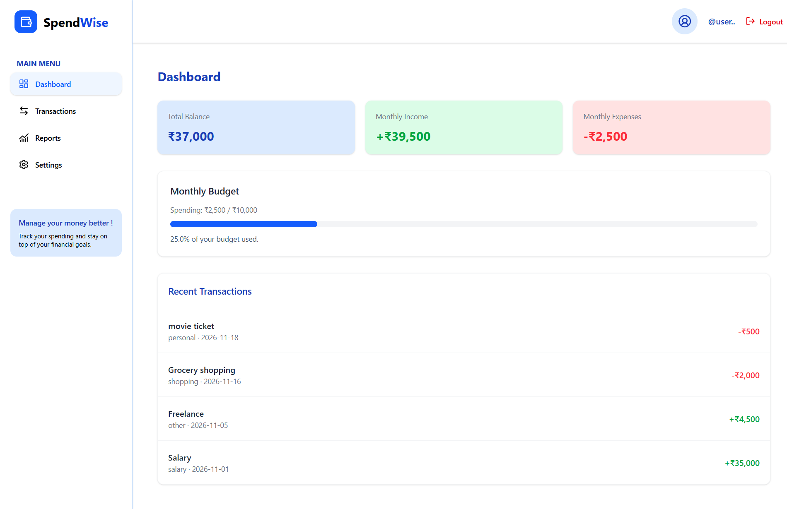
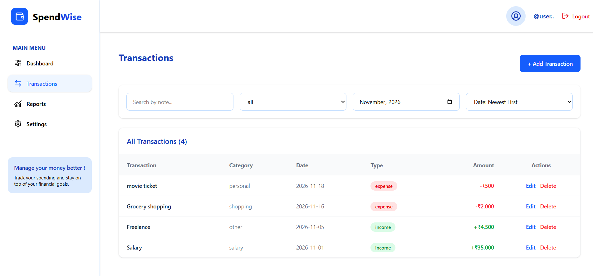
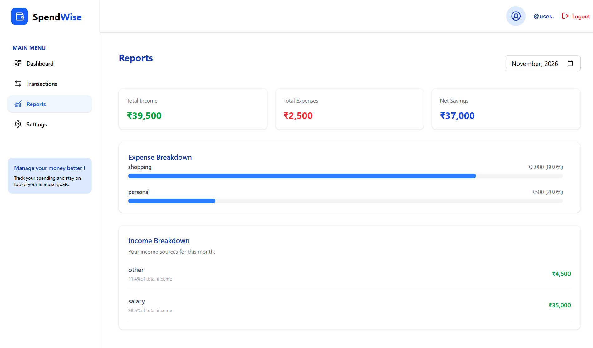
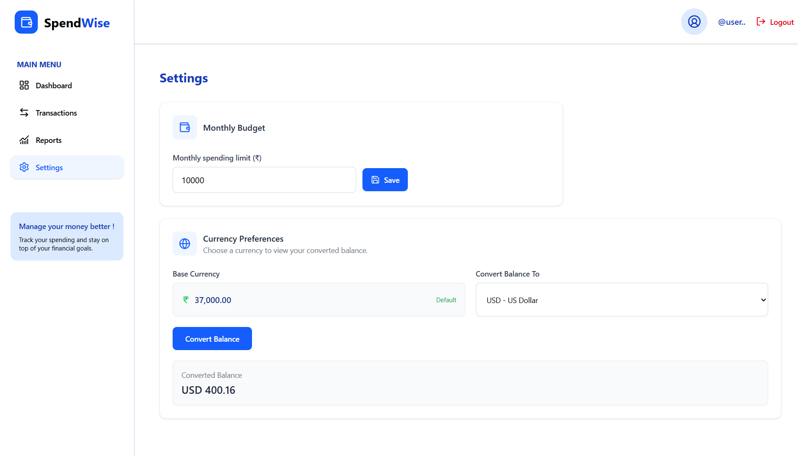

# SpendWise – Expense Manager

SpendWise is a responsive expense management application built using React. It helps users track their income and expenses, manage monthly budgets, and understand their spending habits through reports and category-wise breakdowns.

## 🚀 Live Demo

[View Live Project](https://spend-wise-black.vercel.app/)

## 💻 GitHub Repository

[View Source Code](https://github.com/beherakiran/SpendWise.git)

## ✨ Features
- **Dashboard:** View total balance, monthly income, monthly expenses, budget usage, and recent transactions.
- **Transaction Management:** Add, edit, delete, and manage income and expense transactions.
- **Search and Filters:** Search transactions by note and filter by category and month.
- **Sorting:** Sort transactions by amount and date.
- **Reports:** View monthly income, expenses, savings, and category-wise breakdowns.
- **Monthly Budget:** Set a monthly spending limit with a visual progress bar and warning when 80% of the budget is reached.
- **Currency Conversion:** Convert the current balance from INR to USD or EUR using the Frankfurter API.
- **Authentication:** Simple name-based login with protected routes.
- **Local Storage:** Persist application data across page refreshes.
- **Responsive Design:** Designed for desktop and mobile screens.


## 📁 Project Structure

```text
src/
├── components/
│   ├── common/
│   │   ├── EmptyState.jsx
│   │   ├── Navbar.jsx
│   │   ├── PageHeader.jsx
│   │   └── Sidebar.jsx
│   └── layout/
│       └── RootLayout.jsx
├── context/
│   ├── AuthContext.jsx
│   ├── AuthProvider.jsx
│   ├── TransactionContext.jsx
│   └── TransactionProvider.jsx
├── hooks/
│   └── useLocalStorage.js
├── pages/
│   ├── Dashboard.jsx
│   ├── Transactions.jsx
│   ├── AddTransactions.jsx
│   ├── Reports.jsx
│   ├── Settings.jsx
│   └── Login.jsx
├── routes/
│   └── ProtectedRoute.jsx
├── App.jsx
└── main.jsx
```

## 🛠️ Technologies Used

- React.js
- Vite
- JavaScript
- Tailwind CSS
- React Router DOM
- Context API
- Custom Hooks
- Local Storage
- Frankfurter API
- Lucide React
- React Toastify   

## ⚙️ Installation and Setup

Follow these steps to run the project locally.

**1. Clone the repository**
git clone https://github.com/beherakiran/SpendWise.git

**2. Navigate to the project folder**
cd SpendWise

**3. Install dependencies**
npm install

**4. Start the development server**
npm run dev

**5. Open the application**

Visit the local URL displayed in your terminal, usually:
http://localhost:5173


## 🌐 API Integration

SpendWise uses the [Frankfurter API](https://www.frankfurter.dev/) to retrieve exchange rates.

- Base currency: INR
- Supported conversion currencies: USD and EUR
- Displays converted balance.
- Handles API loading and error states.

## 📸 Screenshots

Add your project screenshots below:

### Login Page


### Dashboard



### Transactions



### Reports



### Settings




